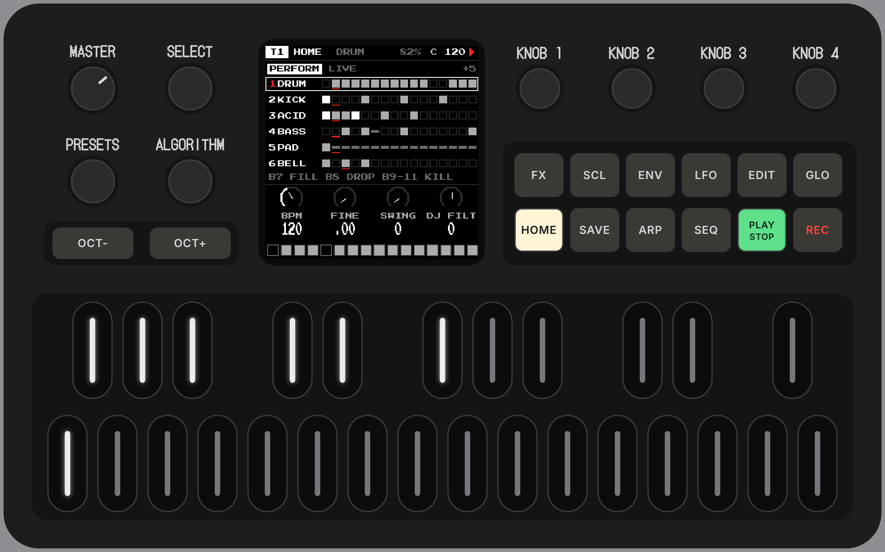

# cursed os

**Custom firmware for the M-VAVE FM-1, with Elektron Syntakt support.**

cursed os turns the FM-1 into a six-track groovebox with an Elektron-style interface: one button per mode, its pages
as tabs, the 16 white keys as trigs, four knobs per page. It is built on [JIANT FM](https://github.com/juanjiant-bit/JIANT)'s
sound engines and sequencer. The screen is black and white, with red only for what is live: the playhead, the knob
being turned, REC, a key change waiting for the bar.

> **Status:** early. cursed os runs on its author's own FM-1 and passes its host tests and the browser emulator, but
> it has not been tried on many units yet. Back up your FM-1 before installing, and keep the official firmware file
> at hand ([INSTALL.md](docs/INSTALL.md)).

## What it does

- **Quick starts** (SAVE > START): a complete loop in one press, in a style (HYPNO, ACID, DUB, BLEEPS, VOICES or RAND). Keep
  the tracks you like and reroll the rest; while playing, a new loop lands at the end of the bar.
- **Generators** (GEN): controlled-random 303 lines, dub chord stabs and held atmospheres, modular-style bleeps,
  Euclidean rhythms. A new part with OCT+, the one before with OCT−, undo per track.
- **The keys set the song's key** (SCL): hold SCL and tap a key, and every synth track moves to that key on the next
  bar. The drums stay.
- **Step sequencing** (SEQ): 16 trigs on the white keys, up to 64 steps, parameter locks, trig conditions, slides.
- **Six tracks** at power-on: DRUM-X kit, KICK, ACID, bass, pad and VOICE. More engines underneath, from JIANT FM:
  FM6 (six operators), analog, FMDRUM, DUB, Karplus-Strong strings, additive and others.
- **Playing live** (HOME): mutes, solos, fills, kills, four sections with morphing, a DJ filter, effect throws.
- **Elektron Syntakt support** (GLO > SYNTAKT): one knob, and the FM-1 follows the Syntakt's clock, start / stop and
  patterns. Its MIDI tracks can play the FM-1 as an extra voice (GLO > SYNTAKT 2): chords, program changes that pick
  from a set of 32 sounds the Syntakt has no machine for, CCs, velocity and aftertouch.
- **On stage** (GLO > STAGE): keys shown as `AMIN/8A` (name and Camelot) and picked either way, a LIVE LOCK, a
  downbeat tap, phrase-aware changes, MIX IN / OUT over a number of bars, BASS SWAP, MONO BASS, and the FM-1 keeps
  playing if the clock drops out.
- **Struck sounds** (MODAL, in the ADD engine): marimba, kalimba, steel pan, tubular bell, slit drum and glass, with
  the mallet's hit and velocity.
- **A clean output**: a look-ahead limiter, an optional soft clipper (SAT), dither.

## Docs

- [Guide](docs/GUIDE.md): the quick start, the cheat sheet and every mode, with screenshots.
- [Installing](docs/INSTALL.md): the web installer, the command line, going back to the official firmware, recovery.
- [Changelog](CHANGELOG.md)
- [Licensing](LICENSING.md)

The docs in `docs/` other than these are JIANT FM's and Felucca's development notes, kept with the history; they
describe JIANT's own interface, not cursed os. JIANT's README is [docs/JIANT-README.md](docs/JIANT-README.md).

## Downloads

Each release on the [Releases page](../../releases) has:

- the firmware package
- the web installer, to run from your own computer
- the command-line installer and the recovery tool
- the browser emulator
- the docs and the licences

The browser emulator is the real firmware compiled to WebAssembly, with sound, played with your computer's keyboard.

## Building

See [BUILDING.md](BUILDING.md) (JIANT's): `tools/get_toolchain.sh` fetches JieLi's toolchain, and with the AC79 SDK
`./build.sh` makes `build/felucca.fwsc`. `tests/run_tests.sh` runs every host test. The browser emulator:
`web/emu/build.sh` (Emscripten) or `web/emu/build_clang.sh` (plain clang and a WASI libc), then
`python3 -m http.server -d build/emu`.

On GitHub, every push to `main` runs the tests and builds the emulator, and the firmware too when JieLi's toolchain
downloads (`.github/workflows/site.yml`). A tag `vX.Y.Z` builds a release (`.github/workflows/release.yml`).

## Credits

cursed os stands on other people's work. Thank you.

- **[JIANT FM](https://github.com/juanjiant-bit/JIANT)** by Juan Jiant: the base of cursed os. Its engines, sequencer,
  songs, MIDI and storage are JIANT's; cursed os is a fork of JIANT V10.19 and keeps its history.
- **[Felucca](https://github.com/hugelton/Felucca)** by Leo Kuroshita (Hügelton Instruments): the platform JIANT is built
  on (hardware layer, USB, update loader, installer, storage).
- **[SLOOP](https://github.com/isod89/sloop-fm1)** by isod89: JIANT's song system.
- **[X0X](https://github.com/charlesvestal/fm1-x0x)** by Charles Vestal: the groovebox layout cursed os follows, the
  browser emulator's design, and the ACID engine's 303 voice: X0X's port of
  **[Open303](https://github.com/RobinSchmidt/Open303)** by Robin Schmidt (MIT), with the Devilfish ranges after jc303
  (midilab), the RAT drive after dm-Rat (Dave Mollen) and the speed-ups after Optimist (henri / hdavid).
- **[HYP-1](https://github.com/RustyPawz/fm1-HYP1)** by RedtailWorks: the idea of the keys setting the song's key
  (written fresh, no HYP-1 code).
- **[FM-1 Transporter](https://github.com/kurogedelic/FM-1-transporter)** and
  **[jl-uboot-tool](https://github.com/kagaimiq/jl-uboot-tool)**: the boot-mode protocol behind the recovery tool.
- **Font**: Press Start 2P (The Press Start 2P Project Authors), SIL OFL 1.1.

The full list, with every licence, is in [LICENSING.md](LICENSING.md).

## Licence

The firmware is `GPL-3.0-only`, like JIANT FM and Felucca: see [LICENSE](LICENSE). cursedsound's own files are also
offered under the MIT licence, so you can reuse them freely as long as you keep the credit; [LICENSING.md](LICENSING.md)
lists them, and the parts by other people with their own licences.

M-VAVE and FM-1 are trademarks of their owners; Elektron and Syntakt are trademarks of Elektron Music Machines.
cursed os is not affiliated with or endorsed by M-VAVE, Elektron, Hügelton Instruments, JIANT FM's author, X0X's or
HYP-1's.
