# cursed os guide

cursed os is custom firmware for the M-VAVE FM-1. It turns the FM-1 into a six-track groovebox, with drums, a kick,
an acid line, a bass, a pad and a sixth voice. Each track has its own sequencer and generators, and it works with an
Elektron Syntakt. This guide is for cursed os 0.18.5.

All screenshots come from the browser emulator, which runs the same firmware.

- [The panel](#the-panel)
- [Quick start: a loop in one minute](#quick-start-a-loop-in-one-minute)
- [Cheat sheet](#cheat-sheet)
- [The modes, one by one](#the-modes-one-by-one)
- [With an Elektron Syntakt](#with-an-elektron-syntakt)
- [Installing](INSTALL.md)

## The panel

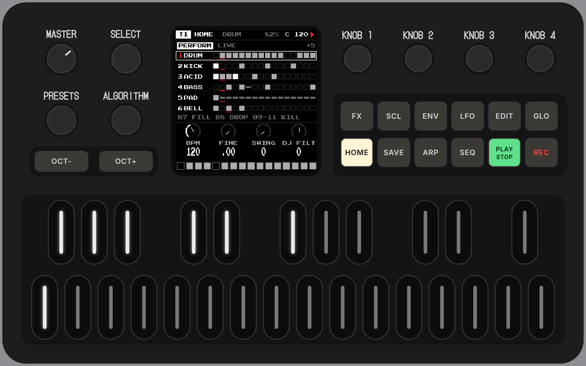

The panel has three areas:

- the screen, with four knobs (KNOB 1–4) to its right
- twelve buttons
- the keyboard (white and black keys)

SELECT turns through pages, and MASTER is the volume.

The buttons keep their M-VAVE labels. On screen, each one opens a cursed os mode under another name:

| Button | Mode on screen | What it is for |
| --- | --- | --- |
| HOME | HOME | Tracks, mutes, tempo, sections: the page to play live from |
| SEQ | TRIG | The steps of the selected track |
| EDIT | SRC | The sound: engine, preset, oscillator, filter |
| ENV | AMP | Envelopes, filter 1, LFO 1 |
| LFO | DRUMS | Rolls, chance and repeats for the kit |
| FX | FX | DJ filter, sends, delay, reverb |
| ARP | GEN | Generators: acid, dub chords, bleeps, euclid |
| GLO | MIX | Mix, limiter, Syntakt link, global settings |
| SCL | KEY | The song's key and scale |
| SAVE | SAVE | Projects, sounds, kits, quick starts |

The top line of the screen shows the selected track (T1–T6), the mode, the sound, the battery, the key and the tempo.

## Quick start: a loop in one minute

cursed os powers on with empty patterns. These five steps get a full loop playing, each with one or two presses.

1. **Open the quick starts.** Press SAVE four times until the tab bar shows START.
2. **Pick a style.**
   - KNOB 1, STYLE: HYPNO, ACID, DUB, BLEEPS or RAND (everything drawn at random).
   - KNOB 2, DRUMS: FULL, PERC (no kick) or NONE.
   - KNOB 3, ELEMENTS: ALL (every track plays) or PICKED (a few voices).
   - KNOB 4, BARS: 1, 2 or 4.
3. **Load it.** Press OCT+. Press it again for another variation of the same style. REC on this page brings back what
   you had before.
4. **Play.** Press PLAY, and the PLAY light turns green.
5. **Play it live.** Press HOME. Black keys 1–6 mute and unmute the six tracks, and white keys 1–6 select a track to edit.

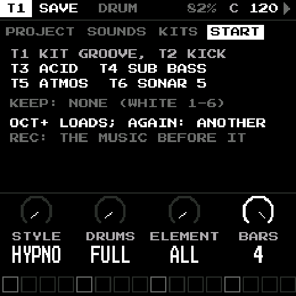 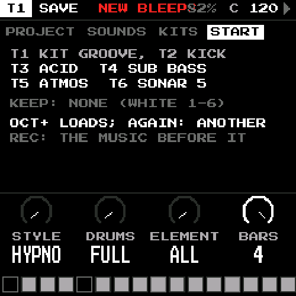

To keep a part you like while you reroll the rest, press its white key (1–6) on the START page. The key lights, and
that track stays. While the loop plays, a new one comes in at the end of the bar.

To save the result, go to SAVE > PROJECT, pick a slot with white keys 1–4 and press OCT+.

## Cheat sheet

### Moving around

| Do this | You get |
| --- | --- |
| Press a mode button | Its main page |
| Press the same button again | The next everyday page (the tab bar shows +N for the extra pages) |
| SELECT up / down | Every page of the mode, including the deep ones |
| White keys 1–6 (HOME) | Pick the track you edit |

### HOME: playing live

| Do this | You get |
| --- | --- |
| Black 1–6 | Mute / unmute a track |
| HOME held + black 1–6 | Solo |
| Black 7 / 8 | FILL / DROP |
| Black 9–11 | KILL low / mid / high |
| White 9–12 | Section A–D, switches on the bar |
| White 13 / 14 | MORPH toward A / B |
| White 15 | LOOP back in phase |
| HOME + white 16 | TAP TEMPO |
| HOME + white 1–8 | Drum sounds in / out |
| HOME + white 9 | PERC in / out |
| HOME + OCT− / OCT+ | Tempo nudge |
| Knobs (PERFORM) | BPM, FINE, SWING, DJ FILT |
| Knobs (LIVE page) | DJ FILT, REVERB, DELAY, FEEDBK |

### Making sounds and patterns

| Do this | You get |
| --- | --- |
| SEQ, then white keys | Steps on / off |
| Hold a step + turn a knob | A lock on that step |
| ARP (GEN) + OCT+ | A new generated part for the track |
| ARP (GEN) + OCT− | The previous generated part |
| REC on GEN | Undo for this track (REC again = redo) |
| FX held + keys | Effect pad |
| FX + OCT+ / OCT− | Latch the effects / all effects off |
| SCL tap | KEY page |
| SCL held + key | Song key |
| SCL + OCT+ | KEY LATCH: notes hold until you press them again |

### Saving and starting

| Do this | You get |
| --- | --- |
| SAVE > PROJECT, white 1–4 | Slot A–D |
| OCT+ / OCT− | Save / load the slot |
| REC twice | New empty project |
| White 9–16 (PROJECT) | Songs |
| SAVE > START, OCT+ | A new loop (at the end of the bar while playing) |
| White 1–6 (START) | KEEP that track on the next reroll |
| REC (START) | Back to the loop before |

### GLO: mix and output

| Page | Knobs |
| --- | --- |
| MIX | LEVEL, PAN, MUTE |
| LIMIT | DRIVE, CEILING, RELEASE, SAT (0 dB by default; turn it to OFF for a clean output) |
| SYNTAKT | ON, PATTERNS, PAT BARS, AUTO LV |
| LINK | PC CH, PC OUT (the program-change channel and whether the FM-1 sends them) |

### Browser emulator keyboard

| Computer key | FM-1 control |
| --- | --- |
| 1 2 3 4 5 6 | FX, SCL, ENV, LFO, EDIT, GLO |
| 7 8 9 0 − = | HOME, SAVE, ARP, SEQ, PLAY, REC |
| [ and ] | OCT− and OCT+ |
| Arrow up / down | SELECT |
| Arrow left / right | ALGORITHM |
| Z X C V B N M , . / | White keys 1–10 |
| S D F H J L ; ' | Black keys |
| Q W E R T Y U I O | Upper keys |

## The modes, one by one

### HOME: play live

HOME is where you play live. The screen shows the six tracks, which of them are muted, and the current section. Black
keys mute, white keys select, and the upper white keys switch sections and morph between them.

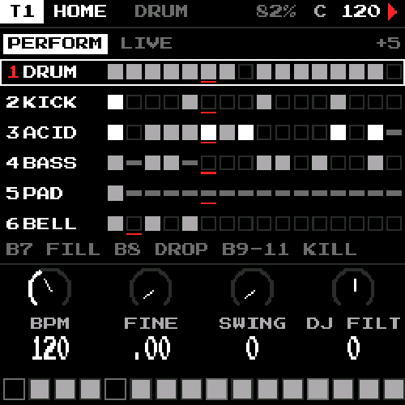

Press HOME again for the LIVE page, with DJ FILT, REVERB, DELAY and FEEDBK on the four knobs. It is a good page to
leave up while you play.

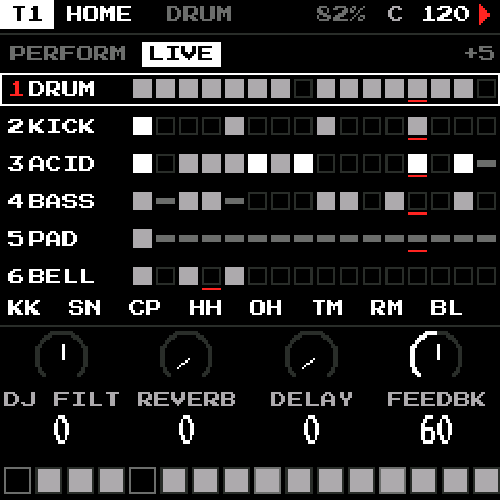

### SEQ (TRIG): steps

White keys are the 16 steps of the selected track. Hold a step and turn a knob to lock a value on that step. More
presses of SEQ reach the COND page (step conditions).

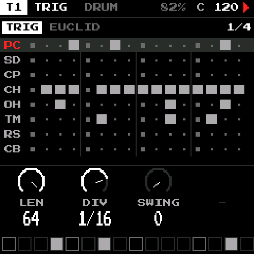

### EDIT (SRC) and ENV (AMP): the sound

EDIT picks and shapes the sound of the selected track: preset, wave and the main tone controls. ENV sets the volume
envelope: attack, decay, sustain, release.

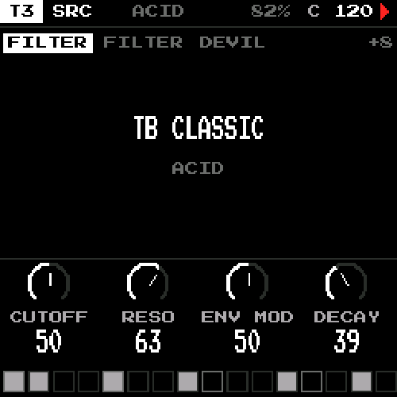 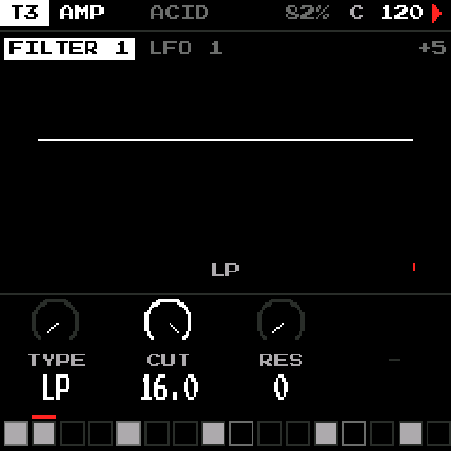

For long pads, load an ATMOS preset on a synth track (here ATMOS DARK on track 5).

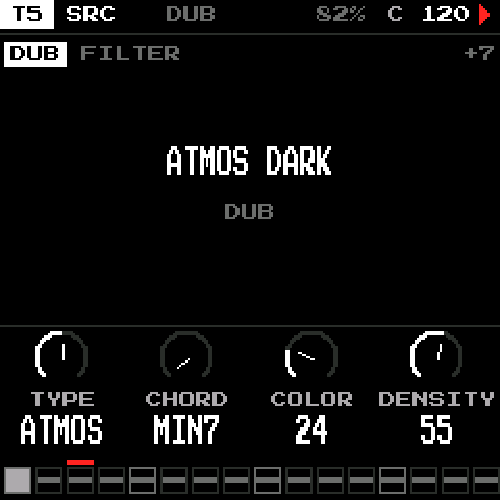

### LFO (DRUMS): the kit

The DRUMS page sets up the drum kit: which drum sounds play and how they are tuned.

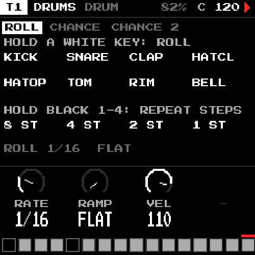

### FX: effects

The FX pages set the reverb, the delay and the other effects. Hold FX and the keys become an effect pad for quick
throws. FX + OCT+ latches them, and FX + OCT− turns all of them off.

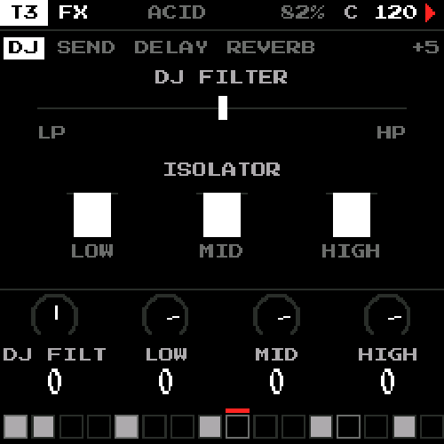

### ARP (GEN): generate parts

GEN writes a part for the selected track in the chosen style. OCT+ gives a new one and OCT− goes back. REC undoes
for this track only, without stopping the music.

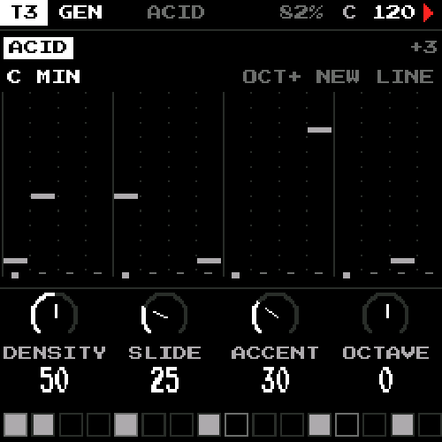

On a synth track, GEN > DUB makes chord stabs. Turn LENGTH past 100% to 1/2, 1, 2 or 4 BARS and the chords are held.
This is the way to atmospheric long chords.

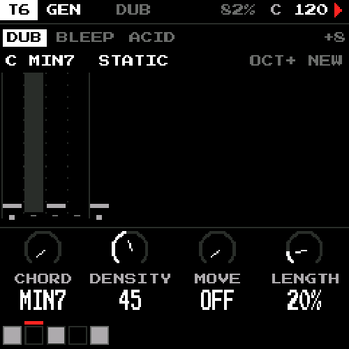

GEN > BLEEP makes modular-style blips:

- MOTIF sets the pattern length (3, 5, 6 or 7 notes).
- DRIFT lets the pattern change slowly.
- SPACE adds a ping-pong echo.

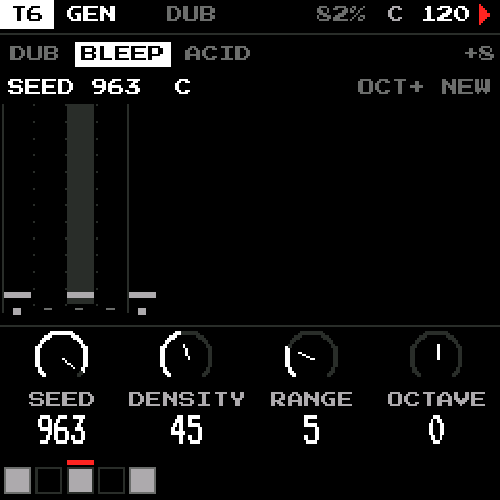

### SCL (KEY): song key

Tap SCL for the KEY page. Hold SCL and press a key to set the song's key: every synth track moves to it on the next
bar, and the drums stay as they are. SCL + OCT+ turns on KEY LATCH, so the keys you play keep sounding until you press
them again (the SCL light shows it is on).

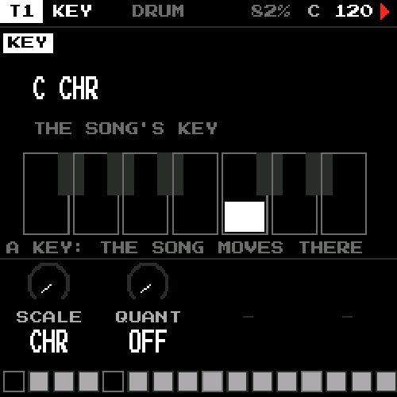

### SAVE: projects and quick starts

On PROJECT:

- White keys 1–4 pick slot A–D.
- OCT+ saves and OCT− loads.
- REC twice starts a new project.
- White keys 9–16 are songs.

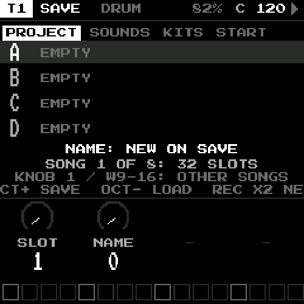

START holds the quick starts from the [Quick start](#quick-start-a-loop-in-one-minute).

### GLO: mix and output

MIX sets level, pan and mute for each track.

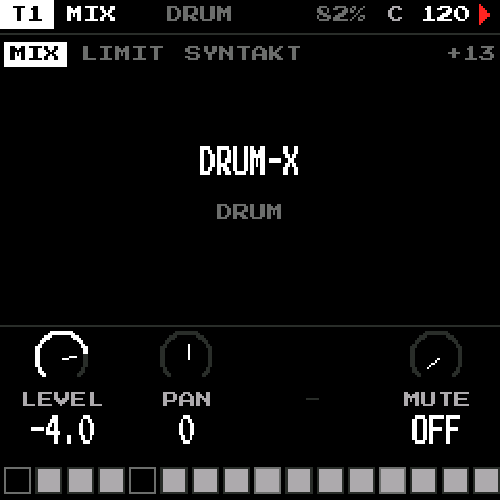

LIMIT protects the output, with DRIVE, CEILING, RELEASE and SAT. SAT is a soft clipper, on at 0 dB by default; turn
it to OFF for a fully clean signal.

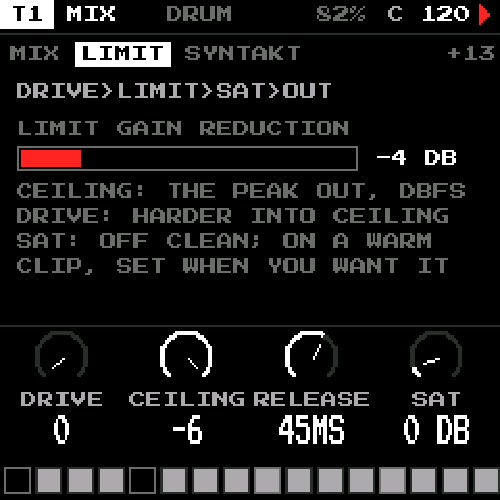

## With an Elektron Syntakt

The FM-1 can play extra voices next to a Syntakt: an acid line, extra drums or bleeps. The Syntakt sets the tempo
and starts and stops both, and its patterns can switch the FM-1's sections.

### Cables

1. Syntakt MIDI OUT → a DIN-to-3.5 mm TRS MIDI adapter → the FM-1's MIDI IN.
2. The FM-1's audio out → the Syntakt's INPUT L/R (3.5 mm stereo to two 6.3 mm mono jacks). The FM-1 then goes
   through the Syntakt's effects and out of its main outputs.

### Syntakt settings (once)

| Menu | Setting |
| --- | --- |
| SETTINGS > MIDI CONFIG > SYNC | CLOCK SEND, TRANSPORT SEND and PRG CH SEND on |
| SETTINGS > MIDI CONFIG > CHANNELS | PROG CHG OUT CH 15 (or set the FM-1's PC CH on GLO > LINK to the one you use) |
| SETTINGS > MIDI CONFIG > PORT CONFIG | OUT PORT FUNC: MIDI |
| SETTINGS > AUDIO ROUTING > EXTERNAL IN | Stereo |

### On the FM-1: one setting

Go to GLO > SYNTAKT and turn ON (KNOB 1). It sets the clock input, follows the Syntakt's program changes on channel
15, sends nothing back and turns AUTO LV (the automatic leveler) off. It stays on after a power-off. The status lines
show whether CABLE, CLOCK and PATTERN are coming in.

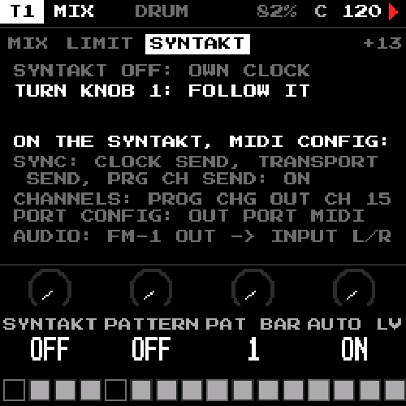

| Knob | What it does |
| --- | --- |
| ON | Syntakt mode on / off (remembered) |
| PATTERNS | Syntakt patterns switch the FM-1's sections: A01 → A, A02 → B, A03 → C, A04 → D, A05 → A … |
| PAT BARS | The length of your Syntakt pattern in bars, so FM-1 changes land at its end |
| AUTO LV | The automatic leveler, off while the Syntakt runs |

### Playing together

- Start the Syntakt, and the FM-1 starts with it, in time.
- SAVE > START with ELEMENTS PICKED gives one or two extra voices on top of the Syntakt. With SYNTAKT ON, DRUMS
  starts at PERC, so the Syntakt keeps the kick. New loops come in at the end of the Syntakt's pattern.
- KEEP (white 1–6 on START) holds the part that works while you reroll the rest.
- HOME > LIVE has the DJ filter, reverb and delay on the knobs; the black keys drop parts in and out.
- If the Syntakt's own drive already colours the sound, turn SAT OFF on GLO > LIMIT.
